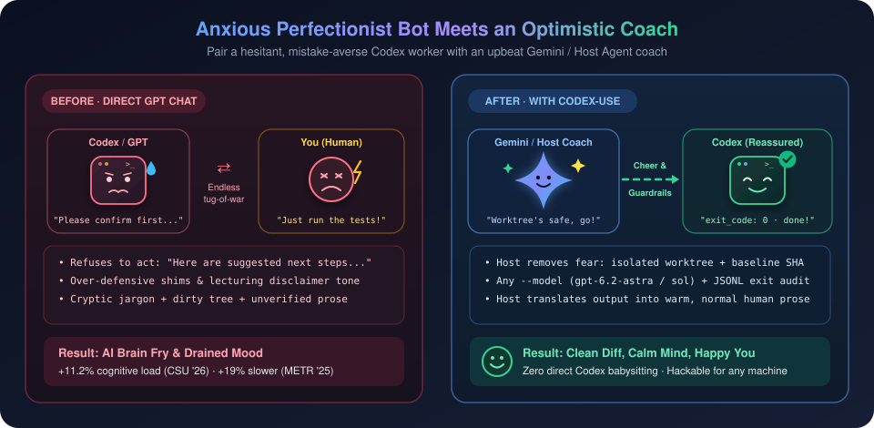

# Codex-use

[中文文档](README.zh-CN.md)

**Stop arguing with GPT and Codex directly. Protect your cognitive bandwidth, keep your good mood, and let your favorite host agent babysit the worker.**

<p align="center">
  
</p>

**Codex-use** is a lightweight, hackable agent skill and zero-dependency Python runner (`skills/codex-use/scripts/drive.py`) that puts any shell-capable host agent (Antigravity, Grok Bot, DeepSeek Harness, Claude Code, Cursor, or your own setup) in front of official headless coding CLIs (`codex` and `dsh`).

You keep Codex's raw coding muscle and pick **any GPT model you want** (`--model gpt-6.2-astra`, `--model gpt-6.2-sol`, or any model your local `codex` CLI supports), while your host agent absorbs the prompt wrangling, isolated git worktrees, JSONL real-command auditing, and rework loops. You read clean human prose and verified diffs instead of fighting a chat window.

## Why Not Talk to GPT / Codex Directly? (Backed by Real Studies)

GPT coding models have a well-known personality quirk: **they are anxious perfectionists who hate speaking plain human**. Left alone in a chat box with a developer, they hesitate out of fear of making mistakes, leak cryptic internal reasoning jargon, stall halfway with "suggested next steps," or over-engineer defensive shims instead of shipping. What they actually respond well to is **an optimistic, confident coach** (such as Gemini in Antigravity, Grok Bot, or DSH) handing them a safe isolated git worktree, reassuring them that a clean baseline commit has their back, cheering on clean slices, and translating the verified result back into human language. Even [OpenAI's own GPT-6.2 prompting guidance](https://developers.openai.com/api/docs/guides/latest-model) explicitly notes that GPT-6.2 leaks reasoning abbreviations and jargon on long tasks and pauses early to propose next steps unless wrapped with clear autonomy prompts.

Recent empirical studies show that **directly supervising and chatting with AI tools takes a real, measurable toll on your mind and mood**:

| Study | What it measured | Key finding |
| --- | --- | --- |
| **BCG x *Harvard Business Review* (Mar 2026)**, Bedard, Kropp et al. ([HBR](https://hbr.org/2026/03/when-using-ai-leads-to-brain-fry)) | Survey of 1,488 full-time US workers on AI oversight fatigue | Coined **"AI brain fry"**: excessive direct interaction with or oversight of AI tools triggers mental fog, headaches, slower decisions, and focus loss (reported by 14% of AI users, elevated in software engineering). |
| **Colorado State University (2026)**, White, Trinkenreich et al. ([arXiv:2611.12019](https://arxiv.org/html/2611.12019v1)) | Objective real-time cognitive workload (tDRT) during AI-assisted code reading | Direct AI interaction created a dual-task penalty that raised **objective cognitive load by +11.2%**, even while developers felt their workload was unchanged. |
| **METR Randomized Controlled Trial (Jul 2025)** ([METR](https://metr.org/blog/2025-07-10-early-2025-ai-experienced-os-dev-study/)) | 16 experienced open-source maintainers across 246 real repository issues | Direct AI tool usage made tasks take **19% longer** on average, even though developers believed they were 20% faster, exposing the hidden tax of manual prompting and rework. |
| **MIT Media Lab x OpenAI (2025)**, Fang, Maes, Agarwal et al. ([MIT Media Lab](https://www.media.mit.edu/publications/how-ai-and-human-behaviors-shape-psychosocial-effects-of-chatbot-use-a-longitudinal-controlled-study)) | 4-week RCT (n = 981, >300k messages) on extended ChatGPT use | Higher voluntary direct chatbot usage consistently correlated with worse psychosocial outcomes across loneliness, reduced real-world socialization, emotional dependence, and problematic use. |
| **Stanford x CMU (*Science* 2026)**, Cheng, Jurafsky et al. ([arXiv:2510.01395](https://arxiv.org/html/2510.01395)) | 11 frontier LLMs + two preregistered studies (n = 1,604) on sycophancy | Models affirmed users **50% more than humans**, promoting unhealthy dependence rather than grounded feedback (see also the [*npj Digital Medicine* 2026 scoping review](https://www.nature.com/articles/s41746-026-03054-x)). |

*Engineering note, not medical advice: the point is simple. Humans are bad at babysitting verbose, quirky worker models turn by turn, and it ruins your mood. Put a structured buffer agent in the middle so your brain stays clear and your workday feels lighter.*

## What Changes When You Use `Codex-use`

- **Better mood, zero direct Codex wrangling.** Talk normally to the host agent you actually enjoy using. It writes structured briefs from built-in templates, handles up to 2 automatic `auto-fix` resume rounds, and reports back in clear human prose.
- **Pick any GPT model and effort tier per task.** Pass `--model <model-id>` (such as `gpt-6.2-astra` or `gpt-6.2-sol`) and `--effort medium|high|xhigh` on every `run`, `resume`, or `review` call. `drive.py` blocks unsupported `ultra` before spawning.
- **No more trusting prose claims.** `drive.py` captures `--json` event streams and returns a compact `AuditSummary` listing real executed commands, real exit codes, changed files, and strict JSON Schema receipts (`--output-schema`).
- **Isolated git worktrees and write locks.** Every `ship` slice runs in its own linked git worktree protected by an exclusive file lock (`exit code 3` on collision), with automatic `.git/info/exclude` hygiene for `.codex-use/` and cache-safe cleanup.

## A Hackable Framework, Not a Rigid Black Box

`Codex-use` is intentionally built as a **small, readable workflow framework** that any agent can adopt and customize:

- **One zero-dependency Python 3.10+ script (`skills/codex-use/scripts/drive.py`)** plus plain Markdown rules (`SKILL.md`, `workers/`, `hosts/`, `templates/`).
- **Honest machine compatibility note.** Out of the box, `drive.py` targets macOS and Linux (using POSIX `fcntl` file locks and local `codex` / `dsh` CLIs) and will not match every workstation or OS verbatim. Because the codebase is flat and has zero third-party packages, a light edit (for example swapping `fcntl` for `msvcrt` on Windows, adding a custom worker adapter to `ADAPTERS`, or tuning the templates to your team's checks) adapts it cleanly to almost any machine or agent workflow.

## Architecture (Host x Worker)

```text
You (calm & happy)
  -> Host Agent (Antigravity / Grok Bot / DSH / Claude Code / any SKILL.md agent)
       -> skills/codex-use/SKILL.md          (worker-agnostic scout / ship / review protocol)
       -> skills/codex-use/scripts/drive.py  (preflight, worktree lock, CLI builder, JSONL auditor)
            ├─ CodexAdapter + workers/codex.md   (codex exec / resume / review, any --model)
            └─ DshAdapter   + workers/dsh.md     (dsh --profile headless)
```

Everything required at runtime lives inside `skills/codex-use/`. Copying or symlinking that single folder preserves every script, schema, template, and relative link.

## Installation

### Universal (`~/.agents/skills`)

Symlink the self-contained skill folder so any `SKILL.md`-compatible agent discovers it:

```bash
git clone https://github.com/semantic-craft/Codex-use.git Codex-use
mkdir -p ~/.agents/skills
ln -s "$(pwd)/Codex-use/skills/codex-use" ~/.agents/skills/codex-use
```

### Antigravity

The repository ships a root `plugin.json` manifest targeting Antigravity. Clone the repository into your Antigravity plugins directory, or symlink `skills/codex-use` into `~/.agents/skills/codex-use`.

### Grok Bot

The repository ships `.grok-plugin/plugin.json` pointing `skills` to `./skills` with zero MCP servers required. Install the repository as a local Grok Bot plugin and enable **Execution on this computer** so `drive.py` reaches your local git repo and worker CLIs.

### DeepSeek Harness (DSH)

The repository ships `package.json` and `cordis.patch.yml` registering `@deepseek-ai/dsh-skill-filesystem`. Install it as a DSH bundle or verify the overlay directly:

```bash
dsh --profile headless --patch /path/to/Codex-use/cordis.patch.yml --dump-config
```

## Quickstart

### 1. Preflight + isolated worktree in one command

```bash
python3 skills/codex-use/scripts/drive.py worktree create \
  --repo /path/to/repo \
  --task fix-retry \
  --preflight \
  --worker codex
```

Standalone preflight for read-only `scout` runs:

```bash
python3 skills/codex-use/scripts/drive.py preflight --worker codex --cwd /path/to/repo
python3 skills/codex-use/scripts/drive.py preflight --worker dsh --cwd /path/to/repo
```

### 2. Read-only `scout` with an explicit GPT model

```bash
python3 skills/codex-use/scripts/drive.py run \
  --worker codex \
  --model gpt-6.2-astra \
  --mode scout \
  --effort medium \
  --cwd /path/to/repo \
  --prompt "Trace how request retries are configured and list the exact files and lines."
```

### 3. Isolated `ship` with strict receipt schema and optional screenshot

Draft the brief from `skills/codex-use/templates/` (`scout-task.md`, `ship-task.md`, or `bugfix-task.md`) under `<worktree>/.codex-use/` (auto-excluded via `.git/info/exclude`):

```bash
python3 skills/codex-use/scripts/drive.py run \
  --worker codex \
  --model gpt-6.2-sol \
  --mode ship \
  --effort high \
  --cwd /path/to/.worktrees/repo/fix-retry \
  --base <base_sha> \
  --schema skills/codex-use/schemas/receipt.schema.json \
  --image /path/to/mockup.png \
  --prompt-file /path/to/.worktrees/repo/fix-retry/.codex-use/fix-retry.md
```

### 4. Same-thread `resume` (`auto-fix`, max 2 rounds)

```bash
python3 skills/codex-use/scripts/drive.py resume \
  --worker codex \
  --session <session_id> \
  --mode ship \
  --cwd /path/to/.worktrees/repo/fix-retry \
  --base <base_sha> \
  --prompt "Fix the off-by-one guard in src/retry.py:42 and re-run python3 -m unittest."
```

### 5. Non-interactive `review`, log `audit`, and cache-safe cleanup

```bash
python3 skills/codex-use/scripts/drive.py review --worker codex --model gpt-6.2-astra --cwd /path/to/worktree --base main
python3 skills/codex-use/scripts/drive.py audit --worker codex --log /tmp/codex-use-logs/run.jsonl --cwd /path/to/worktree --base <base_sha>
python3 skills/codex-use/scripts/drive.py worktree remove --repo /path/to/repo --worktree /path/to/.worktrees/repo/fix-retry --delete-branch
```

## Running Tests

```bash
python3 -m unittest discover -s tests -v
```

## License

Licensed under the [Apache License 2.0](LICENSE).
