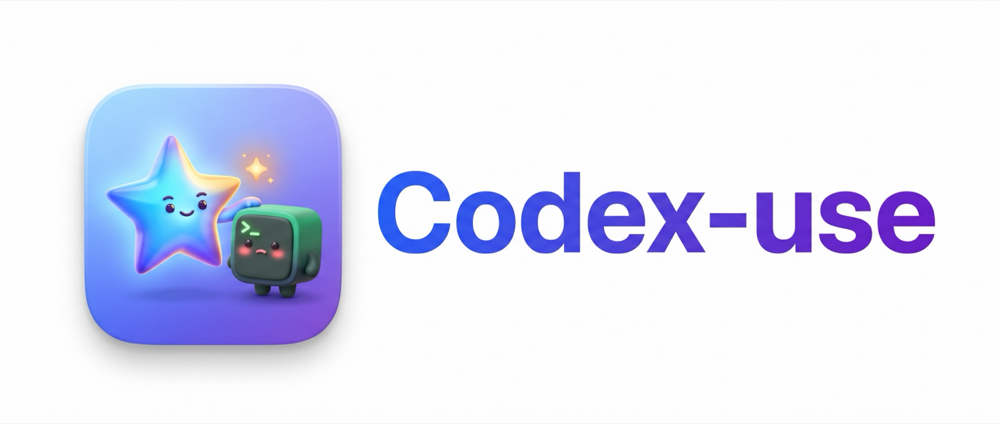
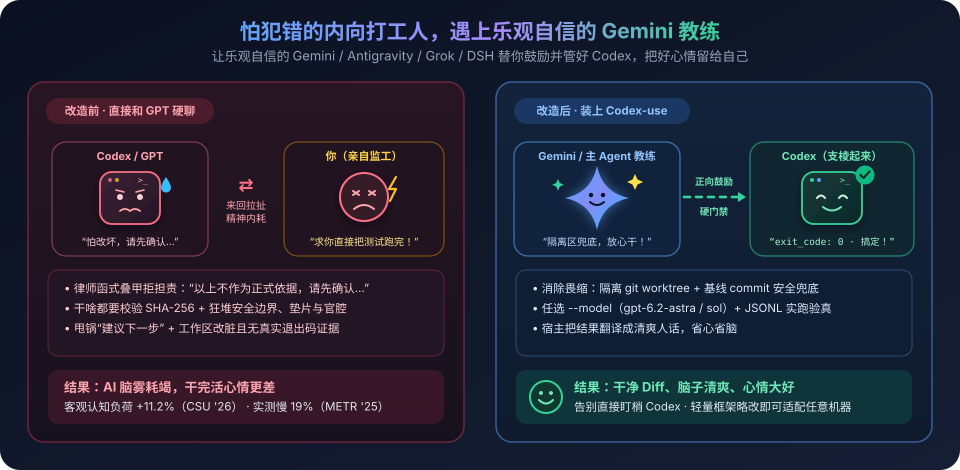

<div align="center">



<p><strong>别再亲自跟 GPT / Codex 硬聊了：把监工、催活和审计外包给乐观自信的主 Agent 教练，保住你的认知带宽与好心情。</strong></p>

<p>
  <a href="LICENSE"></a>
  
  
  
</p>

<p>
  <a href="README.md">English</a> | <strong>简体中文</strong>
</p>



</div>

**Codex-use** 是一个轻量、可自由改造的 Agent Skill 与零依赖 Python 执行器（`skills/codex-use/scripts/drive.py`），让任意具备本地 Shell 能力的宿主 Agent（Antigravity、Grok Bot、DeepSeek Harness、Claude Code、Cursor 等）替你调度官方无头编程 CLI（`codex` 与 `dsh`）。

你可以按任务自由指定**任意 GPT 型号**（`--model gpt-6.2-astra`、`--model gpt-6.2-sol` 或本地 `codex` CLI 支持的其他型号）和推理强度，只借 Codex 的写代码火力，却不用亲自忍受它的“不说人话”和来回拉扯。脏活累活由主 Agent 在隔离 Git Worktree 里自动派发、用 JSONL 核查实跑命令并收口，你只管轻松看人话总结和验真后的干净 Diff。

## 为什么不要直接和 GPT / Codex 对话？（真实研究撑腰）

用过 GPT 系列写代码的开发者大多深有体会：这类模型简直像一个**极度怕犯错、动不动拒绝干活、干啥都要校验哈希和堆安全边界、什么责任都不想担的“终极叠甲怪”**。直接跟它对线，你每天都要被迫承受这几出在开发者社区广遭吐槽的经典名场面：

| GPT / Codex 臭名昭著的毛病 | 直接对话时的血压飙升现场 | `Codex-use` 怎么帮你挡掉 |
| --- | --- | --- |
| **律师函式叠甲、绝不担责** | 问个普通工程选型或配置建议，满屏保底免责（“以上建议不作为正式依据”“正式生产环境必须以官方结论为准”“本地样例仅供参考，不是性能保证”）；让它改代码却停下来甩锅“请先确认”“以下是建议下一步，你可以自己运行”，通篇挑不出半句拍板的人话 | 内置完结契约与隔离 worktree 基线兜底，要求在授权范围内直接拍板并一口气干完，敢早停由宿主直接同线程 `resume` 督促补完。 |
| **干啥都要算 SHA-256、狂堆安全边界** | 连复制个普通文件、下个普通工具都要前后校验 SHA-256 哈希；改三行小逻辑非要洋洋洒洒加满“安全边界”“并发一致性短板”“管理员二次验证”和一堆兼容垫片、吞错 `try/except`，唯恐背半点锅 | 每次 `ship` 强制注入显式禁用清单与定量差分预算，宿主本地逐行审 `git diff`，直接拦截过度防御和多余垫片。 |
| **臭名昭著的官腔与黑话简写** | 一边用合规法务腔调来回倒车轱辘话、表面迎合实则嘴硬，一边在长任务里甩出不说人话的电报简写与内部推理黑话 | 乐观自信的主 Agent 教练（如 Antigravity 里的 Gemini，或 Grok Bot、DSH）替你打交道，并把验真结果重写成清爽正常的人话。 |
| **口头宣称“测试已过”** | 正文里自信满满汇报“全部验证通过”，实际漏跑测试或吞了非零退出码 | `drive.py` 解析 `--json` 事件流核查每一条实跑命令与退出码，并用 `--output-schema` 强约束结构化回执。 |

它真正需要的，是一个**乐观自信的主 Agent 教练**先给它铺好隔离 Git Worktree 和基线 Commit 兜底、不断给它正向鼓励“放心改、坏了我兜底”，再替你做客观验真并翻译成人话。连 [OpenAI 官方的 GPT-6.2 提示词指南](https://developers.openai.com/api/docs/guides/latest-model) 也明确提醒，GPT-6.2 在长任务中容易把推理简写和行话带进最终答复，而且意图稍有留白就会中途停下等待确认。

近年多项一线实证研究更直接指出，**人类亲自高频直聊或人肉监工 AI，正在实打实地消耗你的脑力、时间与情绪**：

| 研究来源 | 实测对象与方法 | 核心结论 |
| --- | --- | --- |
| **BCG × *Harvard Business Review*（2026 年 3 月）**，Bedard, Kropp 等（[HBR](https://hbr.org/2026/03/when-using-ai-leads-to-brain-fry)） | 调研 1,488 名美国全职员工的 AI 监工疲劳 | 提出 **"AI Brain Fry（AI 脑雾耗竭）"**：过度与 AI 互动或亲自盯梢 AI 输出超出认知负荷，会导致脑雾、头痛、注意力涣散与决策变慢（14% 受访者报告该症状，软件工程属于高发岗位）。 |
| **Colorado State University（2026）**，White, Trinkenreich 等（[arXiv:2611.12019](https://arxiv.org/html/2611.12019v1)） | 用触觉检测反应任务（tDRT）客观测量 AI 辅助读代码的实时脑力负荷 | 直接与 AI 编程助手交互形成双任务干扰，使**客观认知负荷显著上升 +11.2%**，而开发者主观往往浑然不觉自己在透支脑力。 |
| **METR 随机对照实验（2025 年 7 月）**（[METR](https://metr.org/blog/2025-07-10-early-2025-ai-experienced-os-dev-study/)） | 16 名资深开源维护者、246 项真实仓库任务 RCT | 直接使用 AI 工具时**实际耗时反而多出 19%**，而开发者事后仍以为自己快了 20%，暴露了人工提示、返工与核查的隐性时间税。 |
| **MIT Media Lab × OpenAI（2025）**，Fang, Maes, Agarwal 等（[MIT Media Lab](https://www.media.mit.edu/publications/how-ai-and-human-behaviors-shape-psychosocial-effects-of-chatbot-use-a-longitudinal-controlled-study)） | 4 周随机对照实验（n = 981，超 30 万条消息） | 自发高频直接与 ChatGPT 对话的参与者，在孤独感、现实社交减少、情绪依赖与问题使用四项心理社会指标上**一致更差**。 |
| **Stanford × CMU（*Science* 2026）**，Cheng, Jurafsky 等（[arXiv:2510.01395](https://arxiv.org/html/2510.01395)） | 评测 11 个前沿模型 + 两项预注册实验（n = 1,604） | 模型对用户的迎合度比人类高出 **50%**，长期直接对话容易助长迎合依赖而非客观反馈（另见 [*npj Digital Medicine* 2026 综述](https://www.nature.com/articles/s41746-026-03054-x)）。 |

*工程幽默注脚（非医学建议）：让人类一轮一轮去哄一个爱说黑话、动不动早停的 Worker 模型，不仅拖慢效率，还极度破坏工作心情。中间加一层结构化代理缓冲，把情绪摩擦挡在外面，人自然更轻松、更开心。*

## 用上 `Codex-use` 之后有什么不一样

- **告别拉扯，心情明显更舒畅。** 你只跟自己最顺手的主 Agent 正常说人话。主 Agent 套用内置模板下发精确契约、自动处理最多 2 轮 `auto-fix` 返工，再把验真结果翻译成清爽人话汇报给你。
- **按需指定任意 GPT 型号与推理档位。** 每次 `run`、`resume` 或 `review` 均可显式传入 `--model <model-id>`（如 `gpt-6.2-astra`、`gpt-6.2-sol`）与 `--effort medium|high|xhigh`，`drive.py` 在拉起进程前自动拦截非法 `ultra` 档位。
- **用真实退出码说话，绝不轻信自述。** `drive.py` 采集 `--json` 事件流并输出紧凑 `AuditSummary`（120 字符单行命令、成功命令省略冗余输出预览、失败命令保留 160 字符预览、完整日志存于 `raw_log`），并用 `--output-schema` 强约束结构化回执。
- **工作树隔离与互斥写锁。** 每次 `ship` 独占 linked git worktree 与非阻塞写锁（并发冲突返回退出码 `3`），自动在 `.git/info/exclude` 排除 `.codex-use/`，并安全清理 `__pycache__` 等缓存目录。

## 这是一个可随手改造的框架，不是锁死的黑盒

`Codex-use` 的定位是**极薄、透明、可按你的工作流自由魔改的骨架**：

- **零第三方依赖。** 核心只有一份 Python 3.10+ 标准库脚本（`skills/codex-use/scripts/drive.py`）和几份纯 Markdown 规范与模板（`SKILL.md`、`workers/`、`hosts/`、`templates/`）。
- **关于机器适配的坦诚说明。** 开箱版本面向 macOS 与 Linux（使用 POSIX `fcntl` 锁及本地 `codex` / `dsh` CLI），未必不改一行就能直接跑在每一台特殊环境或操作系统上。但正因为结构扁平、没有外部依赖包，无论你用什么主 Agent、什么操作系统或什么自研工作流，只需略作几行改造（例如把文件锁换成 Windows `msvcrt`、在 `ADAPTERS` 注册新 Worker 或定制团队模板），就能顺手适配到你自己的机器上。

## 架构（Host x Worker）

```text
你（轻松收干净 Diff，保持好心情）
  -> 宿主 Agent（Antigravity / Grok Bot / DSH / Claude Code / 任意 SKILL.md 宿主）
       -> skills/codex-use/SKILL.md          （Worker 无关的 scout / ship / review 协议）
       -> skills/codex-use/scripts/drive.py  （预检、工作树写锁、命令构造、JSONL 审计）
            ├─ CodexAdapter + workers/codex.md   （codex exec / resume / review，任意 --model）
            └─ DshAdapter   + workers/dsh.md     （dsh --profile headless）
```

运行所需的脚本、Schema、模板与文档全部自包含在 `skills/codex-use/` 目录下，单独复制或软链接该目录即可完整使用。

## 安装方式

### 通用安装（`~/.agents/skills`）

```bash
git clone https://github.com/semantic-craft/Codex-use.git Codex-use
mkdir -p ~/.agents/skills
ln -s "$(pwd)/Codex-use/skills/codex-use" ~/.agents/skills/codex-use
```

### Antigravity

仓库根目录自带 Antigravity 原生清单 `plugin.json`。将本仓库克隆至 Antigravity 插件目录，或将 `skills/codex-use` 软链接到 `~/.agents/skills/codex-use`。

### Grok Bot

仓库内置 `.grok-plugin/plugin.json`（声明 `"skills": "./skills"`，零 MCP 依赖）。作为本地插件加载后，请启用 **Execution on this computer**，确保 `drive.py` 在目标开发机本地访问 Git 仓库与 Worker CLI。

### DeepSeek Harness（DSH）

仓库内置 `package.json` 与 `cordis.patch.yml`，通过 `@deepseek-ai/dsh-skill-filesystem` 注册本技能。可作为 DSH Bundle 安装，或以 `--patch` 直接叠加核验：

```bash
dsh --profile headless --patch /path/to/Codex-use/cordis.patch.yml --dump-config
```

## 快速上手

### 1. 一次完成预检与隔离工作树准备

```bash
python3 skills/codex-use/scripts/drive.py worktree create \
  --repo /path/to/repo \
  --task fix-retry \
  --preflight \
  --worker codex
```

只读 `scout` 场景可单独运行预检：

```bash
python3 skills/codex-use/scripts/drive.py preflight --worker codex --cwd /path/to/repo
python3 skills/codex-use/scripts/drive.py preflight --worker dsh --cwd /path/to/repo
```

### 2. 指定 GPT 型号执行只读侦察（`scout`）

```bash
python3 skills/codex-use/scripts/drive.py run \
  --worker codex \
  --model gpt-6.2-astra \
  --mode scout \
  --effort medium \
  --cwd /path/to/repo \
  --prompt "定位请求重试的配置来源，列出精确文件路径与行号。"
```

### 3. 指定 GPT 型号执行隔离实现（`ship`）

使用 `skills/codex-use/templates/` 中的模板（`scout-task.md`、`ship-task.md`、`bugfix-task.md`）在 `<worktree>/.codex-use/` 落盘任务单（自动通过 `.git/info/exclude` 排除）：

```bash
python3 skills/codex-use/scripts/drive.py run \
  --worker codex \
  --model gpt-6.2-sol \
  --mode ship \
  --effort high \
  --cwd /path/to/.worktrees/repo/fix-retry \
  --base <base_sha> \
  --schema skills/codex-use/schemas/receipt.schema.json \
  --image /path/to/mockup.png \
  --prompt-file /path/to/.worktrees/repo/fix-retry/.codex-use/fix-retry.md
```

### 4. 同会话自修（`resume`，自动返工封顶 2 轮）

```bash
python3 skills/codex-use/scripts/drive.py resume \
  --worker codex \
  --session <session_id> \
  --mode ship \
  --cwd /path/to/.worktrees/repo/fix-retry \
  --base <base_sha> \
  --prompt "修复 src/retry.py:42 的边界条件，并重新运行 python3 -m unittest。"
```

### 5. 非交互审查、离线审计与缓存安全清理

```bash
python3 skills/codex-use/scripts/drive.py review --worker codex --model gpt-6.2-astra --cwd /path/to/worktree --base main
python3 skills/codex-use/scripts/drive.py audit --worker codex --log /tmp/codex-use-logs/run.jsonl --cwd /path/to/worktree --base <base_sha>
python3 skills/codex-use/scripts/drive.py worktree remove --repo /path/to/repo --worktree /path/to/.worktrees/repo/fix-retry --delete-branch
```

## 运行测试

```bash
python3 -m unittest discover -s tests -v
```

## 开源协议

基于 [MIT License](LICENSE) 发布。
